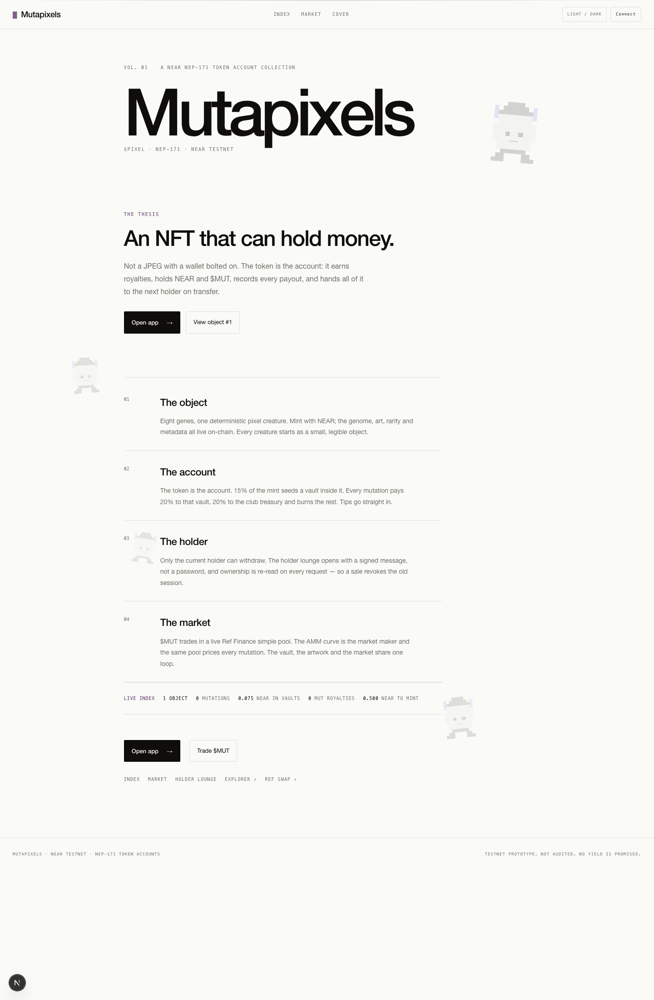
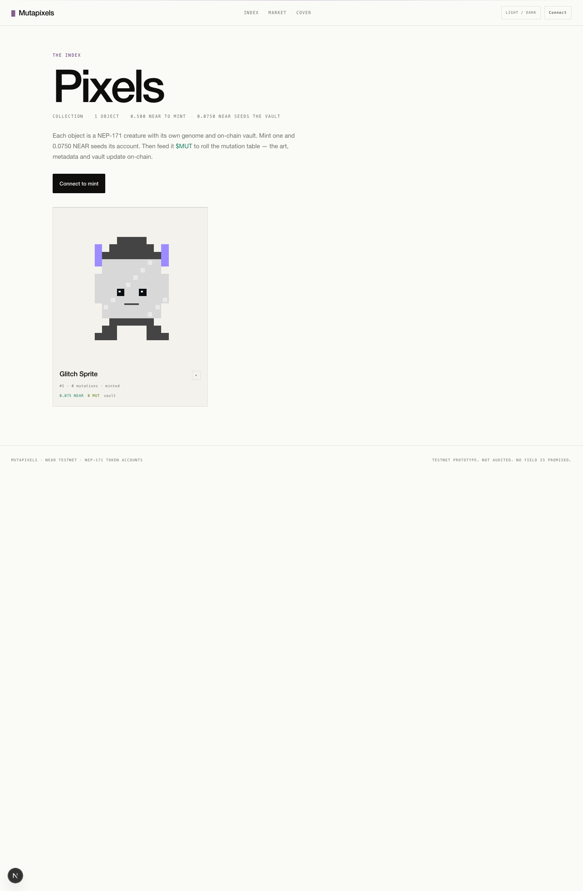
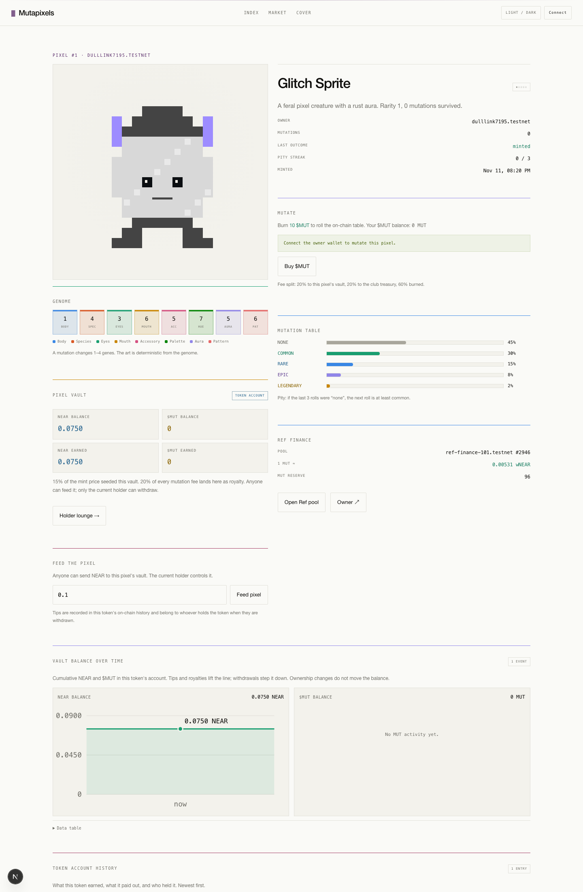
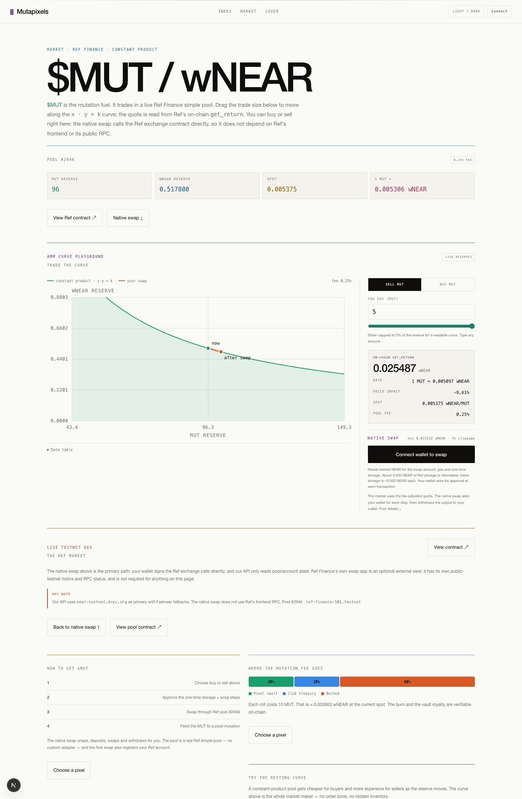

# Mutapixels

> Pixel creatures on NEAR whose NFTs are also small accounts.
> Each token holds money, earns royalties, keeps a full earnings history, and carries
> holder-only access. Sell the NFT and the vault, history and access move with it.

Built for **NEAR Hackathon 2026** · primary track: **`nfts`** (“what comes after the JPEG”).

---

## Live testnet

| Item | Address |
|---|---|
| **Pixel NFT v2 (NEP-171 + vaults)** | **`v2.mutapixels-192217.testnet`** |
| `$MUT` (NEP-141) | `mut-token-192217.testnet` |
| Ref Finance pool | `ref-finance-101.testnet` · pool **2946** (`$MUT / wNEAR`) |
| Legacy v1 NFT | `mutapixels-192217.testnet` (original 3 pixels, kept untouched) |
| Web (public demo, temporary) | <https://difference-modes-amino-ellen.trycloudflare.com> |
| API / renderer / lounge gate (same origin) | <https://difference-modes-amino-ellen.trycloudflare.com/api> |
| Local dev | `http://localhost:3001` / `http://localhost:8788` |
| Public repository | <https://github.com/heyhey3/mutapixels> |

> **Deployment status.** v2 is deployed at `v2.mutapixels-192217.testnet` and reuses
> the existing `$MUT` and Ref Finance pool. The v1 contract at
> `mutapixels-192217.testnet` remains live with its original pixels; the web app points
> at v2. `get_config` on v2 returns `vault_seed_bps: 1500`, `mutation_vault_bps: 2000`,
> `mutation_treasury_bps: 2000`, `mutation_burn_bps: 6000`.
>
> The public demo is currently a **Cloudflare quick tunnel**; the API is same-origin
> through a Next rewrite. The on-chain renderer is set to
> `https://difference-modes-amino-ellen.trycloudflare.com/api/render` and token #1
> metadata was refreshed. Quick tunnels have no uptime guarantee and change URL if
> restarted; for durable judging deploy Vercel + Render per
> [`docs/DEPLOY.md`](docs/DEPLOY.md) and call `set_renderer_base` with the durable API
> URL. The `MODE=migrate` and `MODE=new` paths in
> [`scripts/deploy-testnet.sh`](scripts/deploy-testnet.sh) remain available for other
> environments.
>
> v2 currently holds **one pixel** (token #1, minted from the web app; vault seeded
> with 0.075 NEAR). Mint more from the web app. The old v1 contract still holds its
> original three pixels and can be inspected separately.

---

## What it looks like

| Cover | Index |
|---|---|
|  |  |

| Pixel #1 (vault + history) | Ref market / native swap |
|---|---|
|  |  |

---

## The problem

A JPEG NFT proves ownership of a picture. It cannot hold money, pay its holder, or
gate anything. Marketplaces have to bolt royalties on from the outside, and holder
perks live in a centralized database that the seller keeps after the sale.

Mutapixels makes the token itself the account:

- the NFT mints with **its own vault** (a per-token ledger inside the contract);
- **mutations pay the token a royalty**;
- **anyone can feed** a pixel NEAR or `$MUT`;
- only the **current holder** can withdraw;
- bringing a creature to life is a **probabilistic on-chain mutation** paid in `$MUT`,
  which also gives the token a reason to earn;
- the NFT's **metadata, art and vault** change on-chain as the creature evolves.

NEAR's role is concrete: NEP-171 ownership is the authorization primitive, NEP-141
is the mutation/royalty currency, and a real Ref Finance pool gives `$MUT` a market.

---

## What happens on mint / mutate / transfer

| Action | Money movement | Access movement |
|---|---|---|
| **Mint** (0.5 NEAR) | 15% seeds the pixel vault; 85% goes to the club treasury | Minter holds the token and its vault |
| **Mutate** (10 `$MUT`) | 20% to the pixel vault, 20% to the club treasury, 60% burned | None — holder unchanged |
| **Feed / tip** | 100% into the pixel vault (NEAR or `$MUT`) | None |
| **Withdraw** | Current holder moves the vault to their wallet | None |
| **Transfer** | The vault balance stays with the token | New holder controls the vault; old holder is rejected by the contract; lounge session is revoked on the next request |

The fee split is exposed in `get_config` (`vault_seed_bps`, `mutation_vault_bps`,
`mutation_treasury_bps`, `mutation_burn_bps`) and verified by tests.

---

## Track requirements → implementation

| NFT-track requirement | Where it lives |
|---|---|
| NEP-171 contract with per-token sub-account logic | `contracts/mutapixels/src/lib.rs` — `Vault`, `get_vault`, `withdraw_vault` |
| Club-treasury share held for each token | `mint` credits 15% of the price to the token’s own vault (its member share); the remaining 85% is the club treasury tracked in `treasury_near` |
| Token receives event revenue | every mutation credits 20% of the fee to the token vault as royalty; tips also credit the vault |
| Holder controls the sub-account | `withdraw_vault` requires `predecessor == current owner`; the transfer test proves the old owner is rejected |
| Wallet + balance + access move on resale | vault is keyed by token, not by address; `nft_transfer` leaves the vault in place and the new owner immediately controls it |
| Transfer security documented | [Threat model](#threat-model-transfer-security) below |
| Gated page for current holders only | `/pixels/[id]/club` + NEP-413 challenge/verify API; ownership is re-read from the contract on every request |
| Per-NFT history (earned / paid out / holders) | `get_history`; every mint, tip, royalty, withdraw, transfer and revert is recorded |
| Transfer tests, including a sale mid-payout | 24 Rust tests, including `sale_in_the_middle_of_a_payout_restores_funds_to_the_new_holder` |
| Dynamic NFT | metadata is rewritten on mutation, tip, withdrawal and failed payout; `extra` includes live vault balances |

---

## Architecture

```text
contracts/
  mut_token/        NEP-141 $MUT (mint, transfer, burn)
  mutapixels/       NEP-171 pixel NFT
                    ├── genome + mutation table (paid in $MUT)
                    ├── per-token vault (NEAR + $MUT ledger)
                    ├── per-token history (mint/tip/royalty/withdraw/transfer)
                    ├── club treasury accounting (owner-only)
                    └── NEP-171 approvals (no vault authority)

server/             Hono API
  ├── NEAR RPC views (pixels, vaults, history, config, Ref pool)
  ├── deterministic SVG renderer
  └── NEP-413 holder-lounge gate
      challenge → wallet signature → verify access key + live owner → HMAC session
      every lounge GET re-checks on-chain owner

web/                Next.js 16
  ├── editorial cover (Vol. 01, thesis chapters, ambient pixel art)
  ├── index + detail page (mutate / feed / withdraw / transfer / history)
  ├── holder-only lounge page
  └── Ref pool page (interactive AMM curve, live quote, native swap)
```

**Design notes.** The cover is deliberately art-project editorial: a paper/ink
palette, a narrow left-offset column, huge type, numbered thesis chapters and
low-opacity pixel creatures floating in the margins. The app pages keep that
typographic system and the light/dark toggle, while data marks use a validated
accessible palette. The pixel SVGs have a transparent `?bare=1` variant for the
cover and gallery, and the full card render remains the token metadata media.

### The vault is a sub-account, but not a NEAR account

Each token has a **virtual sub-account** inside the NFT contract: a Borsh `Vault`
keyed by `token_id`, with NEAR and `$MUT` balances plus lifetime earnings. The funds
are custodied by the contract; authorization is `env::predecessor_account_id() ==
owner_of(token_id)` at call time.

We deliberately did **not** create on-chain NEAR sub-accounts with access keys. That
would require handing access keys between wallets on every resale, which is exactly
the failure mode this track asks about. A contract-internal ledger makes the transfer
atomic with NEP-171 ownership and removes the key-handoff attack surface entirely.
A Top Level Accounts-style implementation (one real NEAR account per token) is listed
as future work in [Limitations](#limitations--security-notes).

---

## Threat model: transfer security

The question: **every way a seller could try to keep the money after a sale.**

| Attack | Why it fails / mitigation |
|---|---|
| Seller calls `withdraw_vault` after `nft_transfer` | The method reads the owner from `owner_by_id` at call time and panics unless `predecessor == owner`. A verified test asserts the previous owner is rejected. |
| Seller approves a friend before selling, friend drains the vault | Vault methods never accept or consult NEP-171 approvals. Approvals only authorize `nft_transfer`; the standard clears all approvals on transfer. Test: `approved_account_cannot_withdraw_vault`. |
| Seller starts a `$MUT` withdrawal, then sells while the FT promise is in flight | The FT leg is only a promise. The vault is debited and the amount is held as a pending withdrawal. If the FT transfer fails after the sale, the callback restores the amount **to the token vault** — now controlled by the buyer. Test: `sale_in_the_middle_of_a_payout_restores_funds_to_the_new_holder`. |
| Seller keeps a stale holder-lounge session | The lounge session is bound to `(account, token)` and expiring, but the server also re-reads `owner_of(token)` on **every** request. After transfer the old session receives `403 ownership moved`. |
| Seller front-runs the sale by withdrawing first | **Residual risk.** The seller is the owner until the transfer executes, so they can legitimately withdraw before selling. Mitigation for buyers/marketplaces: display `get_vault` at listing time and use `nft_transfer_call` escrow so the sale and payout settle atomically. The README states this explicitly rather than claiming it is impossible. |
| Seller tries to keep future royalties after the sale | Royalties are credited to the token vault, not to a stored “creator” address. After transfer the new holder earns them. |
| Fake `$MUT` contract calls `ft_on_transfer` | `ft_on_transfer` requires `predecessor == mut_token` and otherwise panics. |
| Malicious `msg` in `ft_transfer_call` | Invalid `msg`, unknown token, wrong amount or non-owner sender returns the full amount to the FT sender instead of panicking; NEP-141 resolves the refund. |
| Reentrancy through the FT callback | Mutation/tip accounting completes synchronously; there is no arbitrary external call. The only cross-contract calls are `burn` (no callback) and holder-chosen `ft_transfer` (bounded callback that can only restore funds to the token). |
| Contract owner drains token vaults | Vault balances are never reachable by owner-only methods. The owner can withdraw `treasury_near` / `treasury_mut` (NEAR subject to vault solvency) and can change `mint_price`, `mutation_cost` and `renderer_base`; those change economics or art URLs, not vault custody. Tests cover vault isolation and treasury solvency. |
| Contract account key redeploys the code | The testnet v2 account currently has one full-access key held by the deployer. A key holder can redeploy the contract and move the account balance, including vault custody. Production plan: remove that key and record the transaction; the separate owner account can still call owner methods. |
| Griefing history storage | History is capped at 100 records per token; oldest entries are dropped. The contract pays history storage, so the cap bounds the exposure. |
| Transfer receiver fails | `nft_transfer_call` uses the standard resolver. A failed receiver returns ownership to the seller and the revert is recorded as `transfer_reverted`. |
| Seller forges a lounge signature | NEP-413 signature must verify against the challenge nonce, the server recipient and either callbackUrl variant; the signing key must exist on the claimed account; challenges are single-use and expire after 5 minutes; lounge sessions are HMAC-signed and expire after 6 hours. |
| Seller replays an old signature | Challenges are one-time (`delete` on verify) and carry a fresh 32-byte nonce plus a timestamp; the signed message includes token and account. |
| Randomness manipulation | **Known limitation.** Mutations use `env::random_seed()` plus token/nonce/block inputs. This is a prototype; commit-reveal or a VRF is the production design. The mutation table and pity rule are public, so a validator cannot silently change the odds. |

The intent is not “trust us”; the intent is that each row is either enforced by a
line of contract code, covered by a test, or disclosed as a residual risk.

---

## Reproduce it

### Prerequisites

- Rust 1.95 + `wasm32-unknown-unknown` (see `rust-toolchain.toml`)
- `cargo-near` (`cargo install cargo-near`), NEAR CLI 0.31+, Node 20+, pnpm 10
- No environment variables are required for the local test suite

### Do X → see Y

```bash
cd /path/to/mutapixels
source scripts/macos-env.sh     # macOS: use CommandLineTools if needed

# 1. Contracts: 24 unit tests + 4 server signature tests + build + typecheck
./scripts/test.sh
#    expected: 24 passed in contracts/mutapixels, 4 passed in server,
#              two WASM artifacts, both TypeScript projects clean,
#              Next.js production build succeeds

# 2. Run the API / renderer / lounge gate
pnpm install
pnpm --filter server dev        # http://localhost:8788/api/health

# 3. Run the web app (separate terminal)
pnpm --filter web exec next dev -p 3001   # http://localhost:3001
```

### What to click

1. **Mint** a pixel on `/pixels` — see the new card show its vault NEAR balance.
2. **Feed** the pixel on its detail page with 0.1 NEAR — see the vault balance and the
   `tip` entry appear in the token history.
3. **Mutate** with `$MUT` — see the genome, art, rarity and metadata update, plus a
   `royalty` history entry showing 20% of the fee.
4. **Withdraw all** as the holder — see the vault drop and a `withdraw` entry.
5. **Transfer** to another account — see the owner and vault holder change together.
6. Open `/pixels/<id>/club` with the old wallet — the server returns `403 ownership
   moved`; the new holder can sign in and open the same lounge.
7. Open `/ref` and drag the trade-size slider — the constant-product curve moves, the
   marker shows the fee-adjusted post-swap reserves, and the card switches to the
   on-chain `get_return` quote. Use the **native swap** in the quote panel to buy or
   sell against pool #2946; it calls the Ref exchange contract directly from your
   wallet and does not depend on Ref's frontend or public RPC. The first swap registers
   Ref storage (~0.03 NEAR, refundable), MUT storage and wNEAR storage (~0.002 NEAR
   each), then wraps, deposits, swaps and withdraws. The Ref app remains available as
   an optional external view.

### Native Ref swap

The `/ref` page does not frame Ref's frontend. The quote panel builds the real
NEP-141 / Ref exchange flow:

1. `storage_deposit` on `ref-finance-101.testnet` (0.03 NEAR, refundable) and
   `register_tokens([MUT])` with exactly 1 yoctoNEAR.
2. `storage_deposit` on the MUT contract and on `wrap.testnet` when the wallet is new
   to either token (~0.002 NEAR each).
3. Buy: `near_deposit` on `wrap.testnet`, then `ft_transfer_call` with empty `msg` to
   Ref. Sell: `ft_transfer_call` of MUT to Ref.
4. `swap` with `{ pool_id: 2946, token_in, amount_in, token_out, min_amount_out }`
   and 1% slippage.
5. Poll Ref's `get_deposits` for the output, then `withdraw` exactly the amount this
   swap produced (1 yoctoNEAR attached), so a pre-existing Ref balance is not touched.

Every step is a wallet approval. The status card checks that the connected testnet
account exists before prompting; if it doesn't, it says so instead of sending a doomed
transaction. The flow is validated on testnet: a 0.01 NEAR buy
returned 1.960784313725490196078431 MUT through pool #2946, and the output was withdrawn
to the wallet. A brand-new account was also taken through Ref storage, token storage,
wrapping and the Ref deposit. If a wallet or public RPC reports an unclear submission
after broadcasting (testnet endpoints sometimes return a 500), the component checks the
on-chain post-condition before failing, so a transaction that landed is not aborted. If
a step fails, the earlier on-chain steps stay done; the next attempt skips completed
registrations.

> The native swap needs an existing testnet account with NEAR. A wallet that has only
> been connected locally may not exist on-chain yet; create/fund it before swapping. The
> first swap locks about 0.034 NEAR of refundable Ref/MUT/wNEAR storage.

### Environment

`server/.env`:

```dotenv
NEAR_RPC_URL=https://near-testnet.drpc.org,https://rpc.testnet.fastnear.com
NFT_CONTRACT_ID=v2.mutapixels-192217.testnet
MUT_TOKEN_ID=mut-token-192217.testnet
REF_CONTRACT_ID=ref-finance-101.testnet
REF_POOL_ID=2946
PORT=8788
GATE_SECRET=use-a-long-random-secret
GATE_RECIPIENT=mutapixels-lounge
# Public API only:
# CORS_ORIGIN=https://your-web.example
# RATE_LIMIT_CAPACITY=300
# RATE_LIMIT_WINDOW_MS=60000
```

`web/.env.local`:

```dotenv
NEXT_PUBLIC_API_URL=http://localhost:8788
NEXT_PUBLIC_NFT_ID=v2.mutapixels-192217.testnet
NEXT_PUBLIC_MUT_ID=mut-token-192217.testnet
NEXT_PUBLIC_REF_ID=ref-finance-101.testnet
NEXT_PUBLIC_REF_POOL_ID=2946
```

---

## Deploy / upgrade

The deploy script signs and sends transactions, so it asks for confirmation unless
`CONFIRM=yes`.

The current v2 deployment used:

```bash
CONFIRM=yes \
OWNER=mutapixels-192217.testnet \
NFT_ACCOUNT=v2.mutapixels-192217.testnet \
MUT_ACCOUNT=mut-token-192217.testnet \
RENDERER_BASE=http://localhost:8788/api/render \
MODE=nft \
./scripts/deploy-testnet.sh
```

Templates for other environments:

```bash
# Safest live demo: fresh NFT only, reusing the existing $MUT and Ref pool.
# Keeps the v1 NFT untouched and needs no state migration.
CONFIRM=yes \
OWNER=you.testnet \
NFT_ACCOUNT=mutapixels-v2-<you>.testnet \
MUT_ACCOUNT=mut-token-192217.testnet \
RENDERER_BASE=https://your-public-api.example/api/render \
MODE=nft \
./scripts/deploy-testnet.sh

# Fully fresh deployment: both accounts must be empty.
CONFIRM=yes \
OWNER=you.testnet \
NFT_ACCOUNT=mutapixels-v2-<you>.testnet \
MUT_ACCOUNT=mut-token-v2-<you>.testnet \
RENDERER_BASE=https://your-public-api.example/api/render \
MODE=new \
./scripts/deploy-testnet.sh

# Upgrade the existing v1 NFT account in place (keeps v1 tokens and metadata).
# The migration is covered by tests, but it modifies the live v1 state; prefer
# MODE=nft if you do not control the v1 account key or want zero risk.
CONFIRM=yes \
OWNER=mutapixels-192217.testnet \
NFT_ACCOUNT=mutapixels-192217.testnet \
MUT_ACCOUNT=mut-token-192217.testnet \
RENDERER_BASE=https://your-public-api.example/api/render \
MODE=migrate \
./scripts/deploy-testnet.sh
```

The script also registers the NFT contract in `$MUT` (`storage_deposit`), which is
required before the contract can receive mutation fees or tips. Deploys sign with the
target contract account’s legacy keychain by default (`SIGN_WITH=sign-with-legacy-keychain`);
set `SIGN_WITH=sign-with-keychain` if the key lives in the near-cli-rs store. For a
public demo, keep the renderer URL public: token metadata points at it. The current
demo uses localhost until the API is hosted. In `migrate` mode the script calls
`set_renderer_base` and `refresh_metadata_batch` (50 tokens per call) so existing token
metadata stops pointing at the old local renderer. Repeat with `from_index=50, 100, ...`
if needed.

After deployment, update the **Live testnet** table at the top of this README,
`server/.env` and `web/.env.local` to the new NFT account (and new `$MUT` account only
for `MODE=new`).

### Public demo hosting

`server/Dockerfile`, `web/Dockerfile` and `docker-compose.yml` are smoke-tested with
Docker: `docker compose up --build` serves the API on `:8788` and the web on `:3001`.
For a real host, set `CORS_ORIGIN`, build the web with the public
`NEXT_PUBLIC_API_URL`, set `API_INTERNAL_URL` for server-side metadata, then call
`set_renderer_base` and `refresh_metadata_batch`. The full path (Docker or
Vercel/Render) is in [`docs/DEPLOY.md`](docs/DEPLOY.md).

For an existing v1 deployment, `migrate` preserves the token map and fills new maps
with empty vaults/histories. New activity credits the vaults; old tokens start at
zero. The contract storage keys for v1 are unchanged, so the upgrade is in place.

### Contract artifact

```bash
./scripts/build.sh
# contracts/mut_token/target/near/mut_token.wasm
# contracts/mutapixels/target/near/mutapixels.wasm
```

---

## API

| Route | Purpose |
|---|---|
| `GET /api/health` | service + contract identifiers |
| `GET /api/pixels` | all pixels with vault balances |
| `GET /api/pixels/:id` | one pixel |
| `GET /api/pixels/:id/vault` | per-token NEAR/$MUT vault |
| `GET /api/pixels/:id/history` | mint / tip / royalty / withdraw / transfer history |
| `GET /api/vault-stats` | total vaults, treasury, tips, royalties, solvency view |
| `GET /api/render/:contract/:id.svg` | live deterministic pixel art |
| `GET /api/config` | prices, fee splits, mutation table |
| `GET /api/ref` | Ref pool reserves + quote |
| `GET /api/ref/quote` (`direction=sell` or `buy`, `amount=<yocto>`) | on-chain Ref `get_return` quote for the curve simulator |
| `GET /api/ref/status/:account` | Ref storage, global/user whitelists, MUT/wNEAR storage, wallet and Ref balances |
| `GET /api/ref/deposits/:account` | Ref `get_deposits`, polled by the native swap |
| `GET /api/balance/:account` | `$MUT` balance |
| `POST /api/gate/:id/challenge` | one-time NEP-413 challenge for the current holder |
| `POST /api/gate/:id/verify` | verify signature + account access key + ownership |
| `GET /api/gate/:id` | gated lounge data; re-checks ownership on every request |

### How the lounge gate works

1. The holder connects a wallet that currently owns the token.
2. `POST /api/gate/:id/challenge` reads `owner_of(token)` and returns a one-time
   message containing the token, account, a 32-byte nonce and an expiry.
3. The wallet signs the NEP-413 message (no transaction, no gas).
4. `POST /api/gate/:id/verify` checks the signature, checks that the signing key is an
   access key of the claimed account, re-checks ownership, and issues an HMAC session
   token bound to `(account, token, exp)`.
5. Every `GET /api/gate/:id` verifies the HMAC, then re-reads the current owner. A
   transfer revokes the previous holder’s session immediately.

Only ed25519 access keys are accepted by the gate implementation. Wallets using
secp256k1 keys can still use the rest of the app, but not the lounge.

---

## Tests

| Test | Proves |
|---|---|
| `mint_creates_pixel_with_metadata_and_vault_seed` | 15% mint seed, metadata, history |
| `mint_refunds_excess_above_price_without_touching_price` | full mint price is retained; only excess is refunded |
| `near_tip_credits_pixel_vault_and_history` | anyone can fund a token vault |
| `mut_tip_credits_vault_and_returns_zero` | NEP-141 tip path and refund semantics |
| `mutation_is_paid_in_mut_and_splits_fee` | 20/20/60 royalty/treasury/burn split |
| `wrong_payment_is_refunded`, `non_owner_cannot_mutate_token` | payment and caller validation |
| `non_mut_contract_cannot_call_ft_on_transfer` | only the configured `$MUT` contract can enter the FT callback |
| `transfer_moves_vault_control_to_new_holder` | vault is token-bound, not address-bound |
| `previous_owner_cannot_withdraw_after_transfer` | stale seller is rejected |
| `sale_in_the_middle_of_a_payout_restores_funds_to_the_new_holder` | failed MUT payout after resale restores funds to the buyer |
| `successful_withdraw_callback_does_not_restore_funds` | success and failure branches are distinct |
| `approvals_do_not_grant_vault_access_and_are_cleared_on_transfer` | approval scope is NFT-only |
| `approved_account_cannot_withdraw_vault` | approved spenders have no vault authority |
| `owner_withdraws_only_the_treasury_share` / `owner_cannot_drain_pixel_vaults` | owner cannot touch token vaults |
| `treasury_withdrawal_respects_vault_solvency` | owner cannot withdraw NEAR needed by token vaults |
| `history_records_earnings_payouts_and_holders_newest_first` | history semantics and pagination |
| `is_holder_tracks_current_owner` | the lounge’s ownership primitive |
| `migration_reads_v1_state_and_initializes_v2_accounting` | v1 state deserializes and the upgrade initializes empty vaults/approvals |
| `migration_is_owner_only` | only the stored owner can run the upgrade |
| `owner_can_refresh_token_metadata_after_renderer_change` | existing token metadata can be rewritten to a public renderer |
| server `nep413.test.ts` (4 tests) | signature verification, callbackUrl variants, tamper rejection |

Run the whole set with `./scripts/test.sh`. It also runs
`./scripts/check-secrets.sh`. CI runs the secret scan, contract tests, server tests,
typecheck and production web build on every push/PR
([`.github/workflows/ci.yml`](.github/workflows/ci.yml)).

---

## Repository layout

```text
mutapixels/
├── contracts/
│   ├── mut_token/          NEP-141 $MUT
│   └── mutapixels/         NEP-171 + vaults + history + migration
├── server/
│   ├── src/index.ts        API, renderer, lounge gate
│   ├── src/nep413.ts       NEP-413 verification
│   └── src/nep413.test.ts
├── web/
│   ├── src/app/pixels/[id]/page.tsx        mutate / feed / withdraw / transfer
│   ├── src/app/pixels/[id]/club/page.tsx   holder-only lounge
│   └── src/app/...                         gallery, Ref pool, home
├── scripts/
│   ├── build.sh
│   ├── test.sh
│   ├── check-secrets.sh
│   └── deploy-testnet.sh
├── docs/
│   ├── SUBMISSION.md       application fields, X thread, publish/renderer steps
│   ├── DEPLOY.md           Docker / Vercel + Render public demo path
│   ├── KEYS.md             privileged-key inspect/remove checklist
│   └── screenshots/        cover, index, pixel, ref
├── .github/workflows/ci.yml
├── server/Dockerfile
├── web/Dockerfile
├── docker-compose.yml
├── README.md
├── DEMO.md
└── LICENSE
```

---

## Disclosure

- **Baseline:** this repository is the hackathon submission; there is no separate
  pre-hackathon product baseline. The public testnet account listed above currently
  runs the earlier v1 build; the v2 vault release is the work described here.
- **Third-party libraries:** `near-sdk` 5.30, `near-contract-standards` 5.30, Ref
  Finance, Hono, Next.js 16, React 19, NEAR Wallet Selector 10.x, `@near-js/transactions`.
  All are used under their respective licenses.
- **AI assistance:** the genome/lore system and the implementation were developed with
  AI coding assistance. The contract is small, covered by tests, and reproducible from
  this repository.
- **Other submissions:** the same human is preparing **Meme Wars**
  (`https://github.com/heyhey3/meme-wars`) for the `memecoins` track. If both projects
  are submitted, each README names the other; Meme Wars is a separate project.

## Submission

Not sent. The public repository is live at
<https://github.com/heyhey3/mutapixels> (CI green). The public demo/renderer, demo
video and X thread are the remaining human actions. The full field table, 5-post X
thread, hosting checklist and pre-submit checklist are in
[`docs/SUBMISSION.md`](docs/SUBMISSION.md). The live rules
are at <https://nearhackathon.com/HACKATHON.md>; the deadline is
**2026-11-14T23:59:00Z**.

The demo video/post is intentionally left to the human submitter: the post must say
the project was built at NEAR HACKATHON, tag `@NEARProtocol` and `#NEARHackathon`, and
link the repo and demo. See [`DEMO.md`](DEMO.md) for a 60-second shot list and
[`docs/SUBMISSION.md`](docs/SUBMISSION.md) for the thread and application fields. A
suggested flow: mint → feed → mutate → withdraw → transfer → show the old lounge
session returning `403`.

---

## Limitations & security notes

- **Not audited.** Testnet prototype; do not put real value in it.
- **Virtual, not on-chain, sub-accounts.** The vault is a contract ledger. A future
  version can map tokens to real NEAR sub-accounts via Top Level Accounts, but that
  requires an access-key handoff design.
- **Randomness.** `env::random_seed()` is validator-influenced. Production mutation
  drops should use commit-reveal or a VRF.
- **Seller can withdraw before a sale.** Buyers must inspect `get_vault`; marketplaces
  should use `nft_transfer_call` escrow. This is the one transfer risk that cannot be
  removed without an atomic sale contract.
- **Lounge gate trust.** Gated content is served by the API; the HMAC secret and the
  RPC endpoint are trusted. The ownership check is live, but a compromised server can
  serve the content anyway. The gate proves holder-key control to the server, not to
  an on-chain verifier.
- **MUT withdrawal failures.** If a holder has no `$MUT` storage, the callback restores
  the amount to the token vault. The NEAR leg is a native transfer and is recorded
  before the promise; a failure of that transfer (deleted account) is not rolled back.
  If the `on_withdraw_transfer` callback itself fails (for example, out of gas), the
  pending withdrawal entry is not finalized and there is no retry method; a v3 should
  add a bounded recovery path. The normal success/failure branches are tested.
- **History cap.** 100 records per token, oldest dropped. This bounds storage griefing.
- **Renderer is local by default.** Token metadata resolves only if `RENDERER_BASE`
  points to a publicly reachable API.
- **Privileged keys.** The v2 contract account currently has one full-access
  deployer key; it can redeploy the contract and move the account balance, including
  vault custody. The separate owner account can change mint/mutation prices and the
  renderer base, and withdraw the treasury (not token vaults). Remove the
  contract-account key for production and record the transaction; both powers are
  disclosed here rather than hidden. The exact inspect/remove checklist is in
  [`docs/KEYS.md`](docs/KEYS.md).
- **$MUT token key.** The NEP-141 `$MUT` owner is the token account itself, and that
  account currently has a full-access key. A key holder can sign as the owner and
  `mint` more supply, or move the token account's NEAR balance. The NFT contract only
  burns its own `$MUT`; it cannot prevent this. Secure or remove the token-account key
  if the demo's supply should be fixed.
- **Owner config changes are not evented.** `set_mint_price`, `set_mutation_cost` and
  `set_renderer_base` are owner-only and currently emit no event; inspect the owner
  account's transaction history. A future version should event or timelock them.
- **Ref pool liquidity is seeded for the demo**, not a market.

---

## License

MIT. See [`LICENSE`](LICENSE).
